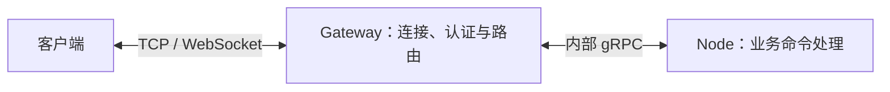

# 长连接服务框架

本项目是基于 Kratos 的 Go 长连接服务框架，用于构建多人游戏、实时互动等需要持续双向通信的后端。客户端通过 TCP 或 WebSocket 连接 Gateway，由 Gateway 认证并转发请求，Node 执行业务命令并返回结果。



Gateway 和 Node 可以分别部署多个实例。框架提供以下能力：

- **请求路由**：无状态业务按负载均衡选择 Node；有状态业务可把玩家绑定到指定 Node，后续请求按绑定路由。
- **消息推送**：向当前连接回复或推送消息，按 UID 定位玩家推送，以及向 Gateway 在线连接广播。
- **应用生命周期**：Gateway 和 Node 作为 Kratos transport 接入 App，管理内部通信、登记、租约和停机排空。

Redis 保存连接定位与 Node 绑定，etcd 提供 Node 注册与发现；需要在线事件和跨 Gateway 广播时可接入 Core NATS。游戏规则、玩家和房间状态、事务及持久化由业务应用管理。

## 目录树

```text
.
├── api/                     # 客户端协议与集群 RPC
├── gateway/                 # 客户端接入与请求路由
├── node/                    # 业务命令与 Session
├── push/                    # 按 UID 推送
├── network/                 # TCP / WebSocket 传输与客户端
├── event/                   # 事件接口与 NATS 实现
├── locate/                  # 绑定定位与 Redis 实现
├── registry/                # etcd 注册与发现
├── instance/                # 实例元数据
├── internal/                # 框架内部组件
├── examples/                # 最小应用与客户端示例，属于根 module
├── test/                    # 游戏、集成测试与压测，独立 module
│   ├── gateway/             # 测试 Gateway
│   ├── ludo/                # Ludo 服务、客户端与压测
│   ├── whot/                # Whot 服务、客户端与压测
│   ├── internal/            # 测试模块共享组件
│   ├── README.md            # 测试模块运行说明
│   ├── buf.yaml
│   ├── buf.gen.config.yaml
│   ├── buf.lock
│   ├── go.mod
│   └── go.sum
├── docs/
│   ├── README.md            # 文档导航、开发验证与维护边界
│   ├── project/             # 项目职责、接入与验证
│   │   ├── integration.md
│   │   ├── architecture.md
│   │   ├── eventbus.md
│   │   └── performance.md
│   ├── harness/             # 编码规范与操作流程
│   │   ├── rules/
│   │   │   ├── go-style.md
│   │   │   └── uber-go/     # 第三方规范原文与许可证
│   │   │       ├── style.md
│   │   │       └── LICENSE
│   │   └── workflows/
│   │       └── commit.md
│   ├── agents/              # 领域文档与本地任务约定
│   │   ├── domain.md
│   │   └── issue-tracker.md
│   └── adr/                 # 架构决策
│       └── 0001-self-contained-transports.md
├── .scratch/                # 本地规格、任务与完成证据
├── AGENTS.md                # AI 开发入口与执行边界
├── GLOSSARY.md              # 领域术语
├── Makefile                 # 生成、构建与验证命令
├── .golangci.yml            # Go 格式化与 lint 配置
├── .gitattributes           # Git 文件属性
├── .gitignore               # Git 忽略规则
├── buf.yaml                 # Protobuf 检查配置
├── buf.gen.yaml             # Protobuf 生成配置
├── go.mod                   # 框架 module
└── go.sum
```

## 快速开始

准备 Go 1.26.6 或更高版本，并启动本机 Redis（`127.0.0.1:6379`）、etcd（`127.0.0.1:2379`）和 Core NATS（`nats://127.0.0.1:4222`）。以下示例使用这三个服务，默认按无密码 Redis 连接。

使用其他地址、Redis 口令或跨主机部署时，先按[示例环境配置](../examples/README.md#环境配置)设置环境变量。随后从仓库根目录打开三个终端，按顺序启动：

| 终端 | 命令 | 作用 |
| --- | --- | --- |
| 1 | `go run ./examples/ludo -id ludo-1` | 启动处理 Echo 命令的无状态 Node |
| 2 | `go run ./examples/gateway -id gateway-1` | 启动 Gateway，接收客户端连接并路由请求 |
| 3 | `go run ./examples/client -addr 127.0.0.1:3101 -service ludo -uid player-1` | 连接 Gateway，认证后向 Ludo 发出请求 |

客户端成功后会输出 `response received`，响应内容为 `ludo: player-1 hello`，之后每 3 秒请求一次。按 Ctrl+C 退出。Whot 示例进一步演示玩家绑定、粘性路由和消息推送，运行方法见[示例说明](../examples/README.md#启动与连接)。

## 业务接入

接入自己的业务时，从[最小接入流程](project/integration.md#最小接入流程)开始：准备认证器与外部依赖，装配 Gateway 和 Node，注册业务 command，再由客户端认证并发起请求。该流程使用无状态 Node，完整代码由可运行示例维护。

需要让玩家的后续请求固定到同一实例时，继续阅读 [Stateful Node 接入](project/integration.md#stateful-node-接入)，由业务决定绑定、续租和解绑时机。已有的 HTTP/gRPC 服务也可以通过 [Sender](project/integration.md#普通-kratos-服务推送)向在线玩家推送消息。

## 开发与验证

根目录与 `test/` 是独立 Go module：前者包含框架和最小示例，后者包含完整游戏、集成测试和压测。根目录的 `go test ./...` 不覆盖 `test/`。

项目尚未上线，按当前设计演进。改动应同步仓内调用方、测试和文档，无需维护历史兼容层或数据迁移流程。

### 常用命令

以下命令均从仓库根目录执行，定义见 [Makefile](../Makefile)。首次开发先用 `make init` 安装检查工具。

| 命令 | 功能与范围 |
| --- | --- |
| `make` / `make help` | 查看根 Makefile 的全部命令与用途 |
| `make init` | 安装 Buf、staticcheck 和 golangci-lint |
| `make api` | 生成根 module 的 API Protobuf 代码 |
| `make build` | 构建根 module 的全部包，不包含 `test/` |
| `make generate` | 运行根 module 的生成器并整理依赖，会更新相关文件 |
| `make check` | 检查根协议与依赖，对两个 module 运行静态分析和测试，检查 Git 空白 |
| `make lint` | 对两个 module 运行 golangci-lint |
| `make race` | 对两个 module 运行竞态检测测试 |
| `make breaking BUF_BREAKING_AGAINST='.git#ref=<tag-or-commit>'` | 检查根 API 相对指定版本的兼容性；替换为实际 tag 或 commit |
| `make all` | 依次执行 `api`、`generate` 和 `check`，会更新相关文件 |
| `make clean` | 删除根目录的 `bin/` 和 `*.exe` 构建产物 |
| `make -C test/ludo help` | 查看 Ludo 应用的生成、构建与测试命令 |
| `make -C test/whot help` | 查看 Whot 应用的生成、构建与测试命令 |

`make check` 不改写受版本控制的文件，也不包含 `make lint`、`make race` 或 `make breaking`；按改动影响选择附加检查。

### 测试入口

单包测试在所属 module 执行。例如，从仓库根目录运行：

```sh
go test ./gateway
(cd test && go test ./...)
```

集成测试和压测的依赖、参数见[测试模块](../test/README.md)及 [Ludo 压测](../test/ludo/README.md#当前-press-入口)。测试编写遵循 [Go 测试规范](harness/rules/go-style.md#测试)：TTL、Redis 原子修改和 etcd 租约由 adapter 测试验证，示例测试验证装配参数。

### 源码导航

理解请求如何进入业务、消息如何回到客户端时，可按以下链路阅读：

| 链路 | 源码入口 |
| --- | --- |
| 认证与请求 | [Gateway 入站与认证](../gateway/inbound.go) → [协议转发](../gateway/forward.go) → [Node 路由](../gateway/backend.go) → [Node RPC 与分发](../node/dispatch.go) |
| 绑定、续租与推送 | [Session 绑定与上下文](../node/session.go)、[请求连接与 UID 推送](../node/push.go) |
| 业务注册、启动与停止 | [command 注册](../node/register.go)、[Gateway 生命周期](../gateway/lifecycle.go)、[Node 生命周期与 Registrar](../node/lifecycle.go) |
| socket 接入与请求处理 | [TCP 连接](../network/tcp/server_connection.go)、[WebSocket 连接](../network/websocket/server_connection.go) |

## 文档导航

| 要做什么 | 阅读入口 |
| --- | --- |
| 理解组件职责、路由与生命周期 | [架构契约](project/architecture.md) |
| 发布事件、订阅与在线广播 | [EventBus 接入](project/eventbus.md) |
| 复测性能、评估容量 | [性能验证](project/performance.md) |
| 查询术语和架构取舍 | [领域术语](../GLOSSARY.md)、[架构决策](adr/0001-self-contained-transports.md) |
| 编写或审查 Go 代码 | [Go 编码规范](harness/rules/go-style.md) |
| 整理并提交改动 | [提交流程](harness/workflows/commit.md) |
| 使用 AI 处理仓库任务 | [AI 开发指南](../AGENTS.md) |

## 维护边界

本文维护项目用途、完整目录树、运行入口和开发命令。装配方法与行为契约放在 `docs/project/`；AI 执行步骤和授权边界放在 `AGENTS.md`，并按任务链接到具体规范。

- 保留一棵完整目录树，随目录变化更新。标题按阅读任务组织，同一主题的步骤、前提和注意事项放在一起，避免重复解释目录或规则。
- 操作说明写清依赖、配置、命令和预期结果；完整代码由可运行示例维护。详细实现链接源码，必要的运行配置直接说明。
- 移动文档或修改标题时，同步所有路径与锚点。第三方规范原文及许可证按 [Go 规范维护约定](harness/rules/go-style.md#来源与维护)更新。
- 部署验收条件随功能文档维护，完成证据放在 `.scratch/<feature>/`；术语和架构决策分别维护在 `GLOSSARY.md` 与 `docs/adr/`，历史记录由 Git 追溯。
- 项目说明使用“本项目”或“框架”等通用称呼；代码和命令中的 API、路径、环境变量与实际实现一致。
