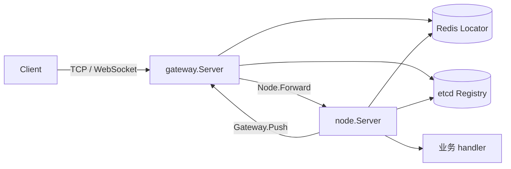

# 架构契约

本文规定组件职责、连接与存储、生命周期和请求语义。接入示例见 [README](./README.md)，待验收项见[当前待办](./issues.md)。

## 1. 边界与组件

Gateway 与 Node 是原生 Kratos App 的 `transport.Server` / `transport.Endpointer` 组件，内部持有 Kratos gRPC Server。每个 App 只有一组 Registry identity，Gateway App 与 Node App 必须独立装配。

| 所有者 / 包 | 职责 |
| --- | --- |
| 外层 Kratos App | identity、配置、日志、完整 transport 列表、hooks、注册及外部依赖回收 |
| `gateway` | 物理 Session、认证、Gate lease、发现、路由、回程 Push/Kick 和广播 |
| `node` | command 注册、protobuf/middleware 适配、request-scoped Session、epoch 与排空 |
| `network`、`network/tcp`、`network/websocket` | 公共连接契约及两种独立的监听、编解码、心跳、队列和 Client |
| `locate`、`locate/redis` | 定位接口、存储编码和原子条件修改 |
| `registry/etcd`、`instance` | 条件注册/本代租约回收、Discovery/Watch 与 sticky metadata |
| `internal/listener`、`internal/gateclient` | listener 所有权、按 Gateway endpoint 复用并回收回程连接 |
| `network/internal/*`、`internal/queue` | 公共认证、心跳、请求跟踪及有界执行规则，不接管 socket 生命周期 |
| `event`、`event/nats` | 在线 Pub/Sub；由应用创建、订阅并关闭，详见 [EventBus](./eventbus.md) |
| 业务 service/usecase | 玩家、Table、事务、幂等与并发执行模型；框架不持有这些状态 |

### 1.1 接入与服务边界

同进程 handler、普通 HTTP/gRPC 入口可调用同一 usecase。直接 Go 调用不附加 Node middleware、Session 或预算。

业务统一管理共享状态和跨入口 Drain。Kratos 并行停止各 transport，Node 只跟踪自身请求；Server 列表顺序不构成排空屏障。

`node.Register` 只注册长连接 command。普通 gRPC service 单独装配，跨进程业务调用使用应用注入的 Kratos client。`api/cluster/v1` 只承担框架 Forward、Push、Kick 和 Disconnect。

普通入口按 UID 推送时，使用已配置 Locator 的 `PushToUID`，不得伪造 Session 或路由。

## 2. 网络与存储

### 2.1 连接与传输

| 连接 | 协议 / 寻址 | 选择方式 |
| --- | --- | --- |
| Client → Gateway | TCP：4B little-endian 长度 + Proto；WS：Binary Message | 外部 LB/DNS |
| Gateway → Node | `discovery:///<service>` unary gRPC | `yola_wrr`；粘性请求精确选择 NodeID |
| Node → Gateway | `direct:///<gate_endpoint>` unary gRPC | `pick_first` |
| Gateway → Gateway | 按旧 GateBinding 的 endpoint 直连 Kick | `pick_first` |

#### 路由与连接复用

回程地址来自认证时写入的 GateBinding，无需发现 Gateway。Node 的发现记录须指向实现 `cluster.v1.Node` 的 endpoint。

resolver 按安全配置选择第一个合法的 grpc/grpcs endpoint，忽略 HTTP endpoint。它不区分业务 RPC 与内部 RPC；内部 gRPC Server 也不承载任意外部 service。

Gateway 按 service 复用一个 WRR ClientConn。service 来自有限部署目录，连接不按时间淘汰。

- 首次建连使用 pool 自有 context 和 `ConnectTimeout`。单个请求取消只结束自身等待，Gateway Stop 才取消共享建连。
- Registry 空快照清空旧地址并拒绝路由；精确路由等待目标 SubConn Ready。发现实例集合不等于 Ready SubConn 集合。
- 回程 gateclient 按 endpoint 管理在途引用与空闲回收，与 service pool 分开管理生命周期。

实现见 [backend](../gateway/backend.go)、[resolver](../gateway/resolver.go) 和 [balancer](../gateway/balancer.go)。

#### 接入、心跳与回调

TCP/WS 分别管理 I/O、deadline、最后一帧和关闭。Stop 关闭准入后，已 Accept/Upgrade 但尚未提交的连接也须拒绝。独立 transport 的临时 bind 失败可在端口释放后重试。

Gateway 实现可选的 `network.HeartbeatHandler`，处理顺序如下：

1. 同步认证，将成功回复放入发送队列。
2. 业务帧进入单 worker FIFO，心跳由读循环独立处理。默认可等待 8 个业务帧，不含当前请求。
3. 业务队列满、回复发送队列满或 handler 失败时关闭连接。
4. 停止时取消在途请求、丢弃等待帧；等待 worker 退出后调用 `handler.Close`。

middleware 须允许同连接的心跳与业务并发。未实现 `HeartbeatHandler` 的 handler 仍同步串行执行。队列等待不计入 handler timeout。

Client 通过有界队列串行执行 connect、push、Kick、disconnect callback：

- 认证前的 Push 与 connect callback 一起计入容量并原子入队，超限时创建失败。
- 关闭时丢弃未开始的普通 callback；当前 callback 完成后依次执行 Kick、disconnect。
- 连接资源先关闭，再放行终止 callback。callback 内调用 Close 不等待自身。

#### 消息所有权与编码

`Connection.SendProto` 成功只表示接纳，不保证已编码或写出。消息须保持只读：

- 调用期间和成功返回后，Proto、Body 及其别名均不可修改；可并发发送同一只读消息。
- 更新消息须创建独立副本。handler/middleware 在交还回复前完成修改。
- 自定义 Marshal 须并发安全、只读访问输入；返回的 bytes 不得复用为可写 scratch。

`PreparedProto` 使用后不得复制。上一批 `SendPrepared` 全部返回后才可 Reset，Reset 不恢复旧消息的写入权。

`SendPrepared` 返回前须结束对视图的访问；之后只能保留不可变编码 bytes，fallback 仍可能持有旧 Proto。Gateway.Broadcast 会另行复制调用者的 Payload。

WS 默认 protobuf codec 不受 Kratos 全局同名注册影响；显式 custom codec 保留自身行为。

#### 监听地址

TCP/WS Server 保存显式 endpoint 的副本，`Endpoint` 也返回副本。scheme 须与 TLS 匹配（tcp/tcps、ws/wss），WS path 须与配置的 Path 一致。

自动地址依次取 `AdvertiseHost`、非通配 listen host、global-unicast interface；无法推导时返回错误。WS 的 `http.Server` 是私有资源，通过 Option 配置，外部不直接调用其 Serve、Shutdown 或 Close。

#### 发送观测

Connection 可实现 `SendStatsProvider`：

- depth/capacity 来自原队列；QueueDropped 只累计 `ErrSendQueueFull`。
- Closed 表示拒绝新发送，writer 可能仍在发送最后一帧。
- PendingPayloadBytes 按 Body 长度累计等待入队和已排队的数据；writer 取走或入队失败时扣除。不含当前帧、编码、socket 和对象开销，不能换算 RSS。
- 关闭保留累计值及残留队列观测；多个字段不是原子快照。

### 2.2 Redis 模型

| Key | 值 | 生命周期 |
| --- | --- | --- |
| `locate:gate:{base64url(service\x00uid)}` | GateBinding JSON | 默认 60s；heartbeat 按需续租 |
| `locate:node:{base64url(service)}:base64url(uid)` | NodeID | 6h；Bind 或成功的 RenewNode 刷新 |
| `locate:node:epoch:{base64url(service)}:base64url(nodeID)` | epoch UUID | 30s；Node 每 10s 续租 |

编码使用无填充 Raw URL Base64。GateBinding 的 ServiceName、UID、GateID、GateEndpoint、ConnID、BindingToken 全部参与条件比较。

Gate key 按 UID 分布；Node binding/epoch 按 service 共用 slot。同一 service 的 Node 读写集中在一个 slot，是容量边界。

#### Node binding 修改权

Session 从 Node 本代 lease 取得 epoch。单机与 Cluster 共用 Lua，原子核验 epoch 后执行操作：

- Bind：显式创建或覆盖绑定。
- RenewNode：当前 NodeID 匹配时，将既有绑定的 TTL 刷新为 6h；不创建或覆盖绑定。
- Unbind：仅删除相同 NodeID 的绑定；绑定缺失或指向其他 Node 时幂等无操作。

epoch 缺失或冲突会关闭 Node 准入并取消本代工作。普通依赖错误或 caller 取消不会自动撤销整个 Node。原 ID 重启取得新 epoch 后可继承并续租原绑定，旧 epoch 的迟到写被拒绝。

有效进程 A 仍可在玩家改绑 B 后，通过 Bind 再次接管。因此保活必须使用 RenewNode，由业务在绑定到期前用有界 context 调度，并在 Drain 返回前停止。框架不自动续租，续租失败也不能退回 Bind。

绑定缺失或改绑分别返回 `ErrNodeNotFound`、`ErrNodeConflict`。Session 映射为 `Aborted`，只拒绝本次续租，不撤销整个 Node。

RenewNode 不检查 GateBinding/BindingToken，也不保证玩家或 Table 的唯一业务 owner。物理连接归属由 GateBinding/BindingToken 单独表示。

本地 lease 失效与 Redis epoch 替换不原子同步，取消 context 不能撤销已发送的 I/O。Lua 只保证当前 Redis 节点内的原子修改；异步复制切主后，已确认数据仍可能回退。

实现见 [Gate 绑定](../locate/redis/gate.go)、[Node 绑定与 epoch](../locate/redis/node.go) 和 [Lua 返回值](../locate/redis/script.go)。

## 3. 生命周期

### 3.1 应用装配

Kratos v3.0.0 的启动顺序为：

`buildInstance`（调用 Endpoint）→ BeforeStart hooks → 调度 Server.Start → Register → AfterStart。

注册不等待 Start 内部就绪。Node 须使用 `server.Registrar(registry)` 等待首次租约核验；失败保留原错误并拒绝登记。listener owner 回收 Endpoint 提前绑定的资源。

- Server、Metadata、Registrar Option 覆盖已有值，hooks 追加。应用一次传入完整 transport 列表，并合并业务 metadata 与 Node.Metadata。Stateful 由 Locator 配置决定。
- Run 可能在 Endpoint、hook 或注册失败时直接返回。应用取消自有 context，以独立有界预算调用 Server.Stop（示例为 10s），再关闭 EventBus、Registry、Redis。保留原 Run 错误，另记清理错误；额外 transport/hooks 也由应用回收。
- 正常 Stop 与业务 Drain 共用 Kratos 传入的预算。Registrar 有独立超时，因此 StopTimeout 不是整个 App 的停止上限。v3.0.0 的显式 App.Stop 可能因注销失败提前返回，应用仍须取消与清理。

Server 初始化失败后同步回滚并进入终态，不支持重新启动或外部并发调用 BeforeStart/Stop。重复 Stop 不会重复业务 Drain，也不会在排空失败时释放 epoch。外部资源是否可重复关闭由其自身契约决定；Stop 超时不代表后台工作已结束。

### 3.2 Gateway

`NewServer` 校验依赖和 Option，安装 handler。`BeforeStart` 校验 App identity，准备内部 gRPC endpoint，Ping Locator，再准备客户端 transport。

准备失败时逆序回滚，每项使用独立的 CleanupTimeout。准备成功后，Start 才开放准入并启动 transport。

Stop 顺序：

1. 关闭准入，等待认证及其同步 takeover Kick。
2. 停止 broadcaster，一次性交接本地全部 Session。
3. 有界 worker 在停止预算内 Kick、关闭连接并清理定位。
4. 停止客户端 transport、内部 gRPC 和 backend ClientConn，汇总错误。

### 3.3 Node

command/disconnect handler 在 BeforeStart 前注册。BeforeStart 校验 identity、endpoint、sticky/Locator 一致性并 Ping；Stateful Node 同时申请 epoch。失败由准备阶段的 owner 回滚。

Start 验证本地有效期并完成首次续租后，才开放 gRPC。启动失败以独立 CleanupTimeout 调用完整 Stop。实现见 [Node 生命周期](../node/lifecycle.go)。

requests 跟踪入站请求和获准的 Registry 登记；deliveries 跟踪 Bind/RenewNode/Unbind/Push。Stop 顺序：

1. 拒绝并排空 Forward/Disconnect 等入站工作。
2. 执行业务 Drain；期间仍可绑定和推送，返回前业务须停止相关生产者。
3. 关闭出站准入，等待已接纳副作用，包括保存 Session 后发起的操作。
4. 停止 gRPC，按排空结果处理 epoch，最后关闭 Gateway ClientConn。

请求、Drain 和出站均排空后，才撤下可服务 identity，停止并等待续租，再按固定代次注销 epoch。

任一排空失败时，停止续租并保留 epoch 到 TTL。只有已获准释放但未完成的注销可在后续 Stop 重试；NotFound/Conflict 表示本代已不再持有该 epoch。

Session 每次使用当前身份，正常停机后不可继续绑定或推送。摘流传播期间，旧路由可收到 Unavailable；Gateway 不补偿重试。

### 3.4 Node epoch

`epochLease` 持有本代固定凭据、本地截止时间、续租与释放状态。identity 用于服务准入，lease 凭据还用于失败后的释放重试；两者不可合并。[实现](../node/epoch.go)

- TTL 为 30s，每 10s 续租。申请和单次续租最多 3s；续租还受剩余租期限制。本地单调时钟从调用开始计时，迟到成功不能延长或恢复失效身份。
- 过期监视独立于续租 I/O。普通错误只在租期内重试；到期或明确的 epoch 缺失/冲突，会关闭入站与出站准入、取消已接纳工作，并使 Start 返回 fatal。
- Forward（含空 sticky claim）、Disconnect、Session 绑定与 Push 均核验有效期，binding 查询后再次检查。Stop 等待任务退出，超时保留凭据；无法强制终止忽略 context 的依赖或业务。
- 本地失效不撤销已完成的业务写入，也不替代业务事务 fencing。fatal 不保证 Kratos 显式 Deregister；摘流仍依赖注册实现及进程退出。

### 3.5 Registry

应用创建 `registry/etcd.New` 并负责 Close。每个 Registry 只尝试注册一次，以 `CreateRevision == 0` 创建空 key。

- 同 service/ID 已存在时返回 `ErrInstanceExists`。默认等待旧 15s lease 失效后重建应用。
- 复用官方 Discovery/Watch 和 Session，只续本代 lease；失租不自动重新登记。
- Deregister 只撤本代 lease。失败回收使用独立的 3s 预算，并保留可重试凭据。
- Registry.Close 停止续租；未注销记录按 TTL 回收。Redis 与 etcd 的操作不组成事务。

## 4. 请求链路

### 4.1 认证与 Gate lease

OpAuth → Authenticator 校验 service/token 并返回 UID → BindGate 写入新绑定并返回旧值 → 提交 Session → 对不同旧绑定同步执行 best-effort Kick → OpAuthReply。

认证不要求 Node 在线。AuthTimeout 从 Open 起算，认证、BindGate 和本地提交共用 deadline。

正常断开的 Unbind 与 Disconnect 共用独立 CleanupTimeout，不继承已取消的连接 context，也不逐步重置预算。异常退出依赖 TTL；heartbeat 在本地剩余 lease 不超过 `LeaseTTL/2` 时续租。

### 4.2 业务请求

OpRequest → 校验 Session/Gate lease → 读取 service 模式 → 定位或选择 Node → gRPC Forward → Node 校验 service、本地租约和 sticky claim → 注入 Session、解码 protobuf、执行 middleware/handler → OpResponse。

已绑定的 Stateful 请求由 Gateway 查询 binding 和 epoch。Node 在 handler 前再次查询 binding 并复核本地身份；改绑后的旧请求须拒绝，已开始的业务不撤销。

Gateway 的业务与心跳分别串行。关闭时依次等待业务锁、心跳锁和 binding 锁；远程 Kick 可在 handler 执行期间使路由失效，因此这些锁不能合并。实现见[转发](../gateway/forward.go)和[分发](../node/dispatch.go)。

typed middleware 接收业务 protobuf，operation 仍为 `/cluster.v1.Node/Forward`。RawHandler 可读取 command，但不自动应用 typed middleware。

`CommandFromContext` 返回实际的 `(int32, present)`，其中 `0` 是合法值；普通或 nil context 返回不存在。

### 4.3 Push、Kick 与 Disconnect

- Session.Push 使用本次请求携带的 GateRoute；PushToUID 先定位当前 Gate。旧 Session 不会自动转向重连后的新连接。
- 回程保留 caller context 和 gRPC status。Gateway 不可用返回 Unavailable；非法 endpoint/TLS 或不一致 route 返回 Internal，不泄漏地址。Gateway 核验目标 identity、完整 binding、lease 和 MaxProtoSize；发送队列满返回 ResourceExhausted。
- 断开与 Gateway 正常停机 best-effort 调用 Node.Disconnect；takeover Kick 不发送该通知。Disconnect 是 at-most-once 连接事件，可能晚于重连，不等于 Logout。业务在状态 owner 内比较 BindingToken 后再更新状态。
- `node.ClientMiddleware` 按配置顺序作用于两种 Push 的回程 RPC；入站 `node.Middleware` 单独配置。应用可注入 OTel 并管理 provider/exporter。LocateGate、mailbox 等待和桌 fanout 不计入 RPC 耗时。
- Disconnect 定位不额外查询 epoch，失败语义与 Forward 不同。支付、结算等副作用仍须由业务实现幂等、事务或串行化。

## 5. Stateful 粘性路由

Node 配置 Locator 即启用 Stateful 租约与绑定，并声明 `sticky=true`。Stateless Node 不能仅为 PushToUID 配置 Locator。

Gateway 首次使用 service 时固定 sticky 模式，endpoint 和 NodeID 继续动态更新。模式变化或混合声明会拒绝路由；切换 Stateful/Stateless 须重启全部 Gateway。

| 情况 | 行为 |
| --- | --- |
| Stateless | service 级 WRR，不查 Node Locator |
| Stateful 未绑定 | 查询为空后 WRR；handler 可调用 BindNode |
| Stateful 已绑定 | 按 NodeID 精确投递；目标不可用、定位失败或 binding 变化时不改投 |
| 未绑定玩家并发首请求 | 可进入不同 Node；有效进程间 binding 为 last-write-wins |
| Gateway 宕机或换 Gateway 重连 | Gate 绑定按 TTL 回收或被新认证覆盖，Node 绑定保留 |
| Node 原 ID 或新 ID 重启 | 原 ID 取得新 epoch 可继承路由；新 ID 需业务改绑或等旧绑定过期 |
| 同 service/NodeID 双活 | 后启动者 epoch 注册失败；不匹配的 claim 返回 Aborted |
| Redis 不可用 | 依赖该次查询的请求失败；Node 在本地租期截止时关闭准入 |

Gateway 不缓存玩家 binding 或未绑定结果；close、takeover、heartbeat 不修改 Node binding。绑定续租与修改权见 [Node binding 修改权](#node-binding-修改权)。

业务负责强单活、内存状态恢复、同 UID 串行、actor 唯一性和故障迁移；粘性路由不提供这些保证。

## 6. 协议、错误与默认值

### 6.1 外部协议

| Op | 方向 / 含义 |
| --- | --- |
| OpAuth / OpAuthReply | C→S / S→C；每连接一次认证 |
| OpHeartbeat / OpHeartbeatReply | C→S / S→C；存活与按需续租 |
| OpRequest / OpResponse | C→S / S→C；seq 关联，cmd 路由 |
| OpPush | S→C，无 seq |
| OpKick | S→C，最后一帧后关闭，code 说明原因 |

序列化 Proto 上限为 4096B。Proto.code 是唯一框架状态，由 gRPC status 映射；业务状态放在响应 body。

外部协议无 deadline 或取消帧，客户端截止时间不随消息进入服务端。见[协议源定义](../api/protocol/v1/protocol.proto)。

### 6.2 默认值

| 层 | 配置 | 默认值 |
| --- | --- | --- |
| Gateway | gRPC handler / RPCTimeout / AuthTimeout / LeaseTTL | 3s / 3s / 15s / 60s |
| Gateway | ConnectTimeout / LeaseTimeout / CleanupTimeout | 各3s |
| Gateway 广播 | worker / queue | min(8, GOMAXPROCS) / 256 |
| Node | handler / PushTimeout / 启动回滚 CleanupTimeout | 各 3s |
| TCP Server | handler / handshake / heartbeat / write / send queue | 3s / 15s / 15s / 10s / 32 |
| TCP Client | ping / read / write / send queue | 5s / 15s / 10s / 100 |
| WS Server | handler / handshake / read / write / send queue | 3s / 15s / 60s / 10s / 32 |
| WS Client | ping | 15s |
| TCP/WS Server | HeartbeatHandler 等待业务帧 | 8，不含当前请求 |
| TCP/WS Client | request / callback queue | 30s / 64 |
| 连接限制 | MaxConnLimit / MaxConnPerIP | 10,000 / 100 |

TCP/WS 的 Timeout、Node 的 HandlerTimeout 可覆盖单次 handler 预算；AuthTimeout 管理未认证阶段的总时长。

TCP Client 的 read timeout 须大于 ping 间隔。Client 断开后由调用者新建实例；总连接数与 per-IP 限制分别核对。

### 6.3 请求预算与超时职责

同一 context 链取父 deadline 与本层上限的较早值。只放宽 Gateway RPC，仍可能被 transport 或 Node 的预算截断；FIFO 等待不计入从实际调用起算的 handler 预算。

| 所有者 | 范围与边界 |
| --- | --- |
| TCP/WS Client Request | 限制本地等待；迟到响应按 seq 丢弃，不撤销已发送帧 |
| TCP/WS Invoker → Gateway Forward → Node handler | 默认各 3s；Forward 覆盖定位与 RPC，内部 client 不叠加 Kratos 隐式超时；gRPC 传播上游 deadline |
| Gateway ConnectTimeout | 依赖准备与共享 backend 建连；调用者只控制自身等待 |
| Gateway LeaseTimeout | 单次 Gate 续租，仍服从 heartbeat handler 的更短 deadline |
| Gateway CleanupTimeout | 断线/Kick 清理独立于 caller 取消；Session 排空服从 Stop 总预算，启动回滚逐项独立计时 |
| Node PushTimeout | 每次 LocateGate 与回程 RPC；业务同步多次 Push 各自计时 |
| Node CleanupTimeout | 准备/启动失败回滚；正常 Stop 使用调用方预算。epoch 申请和单次续租另有 3s 上限，注销沿用 Stop 或回滚预算 |
| Ludo 入座 / 清理 | 5s / 独立 2s，从 Bind 后的 background context 派生，不含创建玩家与 Bind |
| Whot 入座 / 清理 | 2s / 独立 2s；保留入座与清理错误链 |

测试 Gateway 的 `-rpc-timeout` 同时配置 WS handler 和 Gateway Forward，Node 仍使用自身配置。Ludo YAML 的 handler 为 5s，历史压测为 15s，容量结论不能混用。见[运行配置](../test/README.md#本地启动)。

业务 mailbox 中尚未开始的任务可取消；已开始的任务须等待完成或由业务回滚。多次同步 Push 可超过入座等待预算。`TryPost` 只作有界准入；`Post` 的 context 只限制等待容量，已接纳的普通任务不随提交 context 取消。

物理断连或 Forward 超时会取消在途 Node context。handler 返回前，Node 仍跟踪该请求；Stop 先等待请求，再执行 Drain。业务自行启动的后台任务由 Drain 回收。

Redis client 创建方须启用 `ContextTimeoutEnabled` 并设置有限的读写 timeout。根示例、测试应用和压测已启用；Locator 不修改注入的共享 client。

网络 timeout 与 caller 取消或 deadline 同时生效时，错误链保留网络错误和 context 错误。独立网络 timeout、存储业务错误及成功结果保持原样。见 [Locator 实现](../locate/redis/locator.go)和[回归测试](../locate/redis/locator_test.go)。

cancel 不保证立即中断已开始的 Redis I/O，超时也不能证明写入未执行。调用方用有限预算限制等待，以原子条件写或业务幂等处理迟到结果。完整游戏与长期 SLO 按[容量验收](./issues.md#i41-和-i45-容量与延迟)验证。

## 7. 部署与安全约束

- Stateful Node ID 稳定且在线唯一。同一部署中的 Gateway、Node、Locator 使用一致的协议、key 和 epoch 契约。
- Registry endpoint 与 GateBinding 中的 Gateway 地址须对调用方可达。内部 TLS 两端成对启用，grpc/grpcs 与配置一致；endpoint 为带非零数字端口的 host:port，不带 userinfo、path、query 或 fragment。
- Server TLS 提供 Certificates、GetCertificate 或 GetConfigForClient 之一，生产禁止 InsecureSkipVerify。Option 复制 tls.Config 顶层；共享证书元素、证书池和动态 callback 的并发安全由调用方负责。
- 认证与限流默认使用 socket peer；采用代理真实 IP 前须定义信任边界。生产凭据、ACL/mTLS、限流和容量按部署验收。
