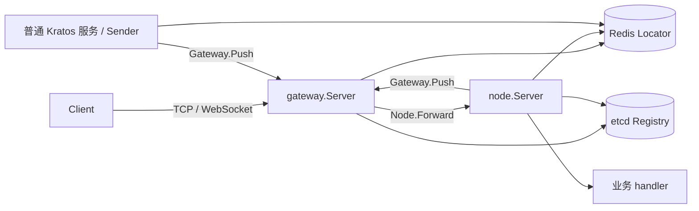

# 架构契约

本文规定组件职责、生命周期和对外行为契约。装配见[长连接接入](integration.md)，实现入口见[源码导航](../README.md#源码导航)。

| 关注点 | 阅读章节 |
| --- | --- |
| 组件职责与服务边界 | [边界与组件](#1-边界与组件) |
| 认证、请求、推送与断线 | [请求链路](#2-请求链路) |
| 玩家绑定与故障路由 | [Stateful 粘性路由](#3-stateful-粘性路由) |
| 装配、启停、epoch 与登记 | [生命周期](#4-生命周期) |
| 连接、消息所有权与 Redis 修改权 | [网络与存储](#5-网络与存储) |
| 协议、配置及各层超时预算 | [协议、配置与超时](#6-协议配置与超时) |
| 部署验收前提 | [部署与安全约束](#7-部署与安全约束) |

## 1. 边界与组件

Gateway 与 Node 是原生 Kratos App 的 `transport.Server`，内部持有 Kratos gRPC Server，不实现 `transport.Endpointer`。内部地址由组件管理，不进入普通应用记录。Gateway、Node 可各自部署多个实例；普通无状态 Kratos 服务保留标准 HTTP/gRPC 注册与调用。

| 所有者 / 包 | 职责 |
| --- | --- |
| 外层 Kratos App | identity、配置、日志、完整 transport 列表、hooks、普通服务注册及外部依赖回收 |
| `gateway` | 物理 Session、认证、Gate lease、发现、路由、回程 Push/Kick 和广播 |
| `node` | command 注册、protobuf/middleware 适配、Session、内部登记、epoch 与排空 |
| `push` | 按目标游戏和 UID 查询当前 Gate 并推送 |
| `network`、`network/tcp`、`network/websocket` | 公共连接契约及两种独立的监听、编解码、心跳、队列和 Client |
| `locate`、`locate/redis` | 定位接口、存储编码和原子条件修改 |
| `registry/etcd`、`instance` | 条件注册/本代租约回收、Discovery/Watch 与 sticky metadata |
| `event`、`event/nats` | 在线 Pub/Sub；由应用创建、订阅并关闭，详见 [EventBus](eventbus.md) |
| 业务 service/usecase | 玩家、Table、事务、幂等与并发执行模型；框架不持有这些状态 |

### 1.1 接入与服务边界

同进程 handler、普通 HTTP/gRPC 入口可调用同一 usecase。直接 Go 调用不附加 Node middleware、Session 或预算。

业务统一管理共享状态和跨入口 Drain。Kratos 并行停止各 transport，Node 只跟踪自身请求；Server 列表顺序不构成排空屏障。

`node.Register` 只注册长连接 command。普通 gRPC service 单独装配，跨进程业务调用使用应用注入的 Kratos client。`api/cluster/v1` 只承担框架 Forward、Push、Kick 和 Disconnect。

普通服务按 UID 推送使用独立 `push.Sender`，明确目标游戏命名空间。Node 内部使用配置 GateDirectory 的 `Server.PushToUID`，继续受本代 epoch 和副作用准入保护。

## 2. 请求链路

### 2.1 认证与 Gate lease

OpAuth → Authenticator 校验 service/token 并返回 UID → BindGate 写入新绑定并返回旧值 → 提交 Session → 对不同旧绑定同步执行 best-effort Kick → OpAuthReply。

认证不要求 Node 在线。AuthTimeout 从 Open 起算，认证、BindGate 和本地提交共用 deadline。

正常断开的 Unbind 与 Disconnect 共用独立 CleanupTimeout，不继承已取消的连接 context，也不逐步重置预算。异常退出依赖 TTL；heartbeat 在本地剩余 lease 不超过 `LeaseTTL/2` 时续租。

### 2.2 业务请求

OpRequest → 校验 Session/Gate lease → 读取 service 模式 → 定位或选择 Node → gRPC Forward → Node 校验 service、本地租约和 sticky claim → 注入 Session、解码 protobuf、执行 middleware/handler → OpResponse。

已绑定的 Stateful 请求由 Gateway 查询 binding 和 epoch。Node 在 handler 前再次查询 binding 并复核本地身份；改绑后的旧请求须拒绝，已开始的业务不撤销。

远程 Kick 可在 handler 执行期间使路由失效；并发规则见[接入、心跳与回调](#接入心跳与回调)。

typed middleware 接收业务 protobuf，operation 仍为 `/cluster.v1.Node/Forward`。RawHandler 可读取 command，但不自动应用 typed middleware。

`CommandFromContext` 返回实际的 `(int32, present)`，其中 `0` 是合法值；普通或 nil context 返回不存在。

### 2.3 Push、Kick 与 Disconnect

- Session.Push 使用本次请求携带的 GateRoute；Server.PushToUID 和独立 Sender 先定位当前 Gate。旧 Session 不会自动转向重连后的新连接。Sender 的目标 service 显式传入，不取发送服务的 App.Name。
- 回程保留 caller context 和 gRPC status。Gateway 不可用返回 Unavailable；非法 endpoint/TLS 或不一致 route 返回 Internal，不泄漏地址。Gateway 核验目标 identity、完整 binding、lease 和 MaxProtoSize；发送队列满返回 ResourceExhausted。
- 断开与 Gateway 正常停机 best-effort 调用 Node.Disconnect；takeover Kick 不发送该通知。Disconnect 是 at-most-once 连接事件，可能晚于重连，不等于 Logout。业务在状态 owner 内比较 BindingToken 后再更新状态。
- `node.ClientMiddleware` 按配置顺序作用于两种 Push 的回程 RPC；入站 `node.Middleware` 单独配置。应用可注入 OTel 并管理 provider/exporter。LocateGate、mailbox 等待和桌 fanout 不计入 RPC 耗时。
- Disconnect 定位不额外查询 epoch，失败语义与 Forward 不同。支付、结算等副作用仍须由业务实现幂等、事务或串行化。

## 3. Stateful 粘性路由

Node 默认无状态。配置 `Stateful` 后启用 epoch 与绑定，并自动声明 `sticky=true`；传入 nil（含带类型 nil）会使构造失败。`GateDirectory` 与模式无关；Stateless Node 也可按 UID 推送。只有推送需求的普通服务直接使用 Sender。

Gateway 首次使用 service 时固定 sticky 模式，endpoint 和 NodeID 继续动态更新。模式变化或混合声明会拒绝路由；切换 Stateful/Stateless 须重启全部 Gateway。

| 情况 | 行为 |
| --- | --- |
| Stateless | service 级 WRR，不查 Node Locator |
| Stateful 未绑定 | 查询为空后 WRR；handler 可调用 BindNode |
| Stateful 已绑定 | 按 NodeID 精确投递；目标不可用、定位失败或 binding 变化时不改投 |
| 未绑定玩家并发首请求 | 可进入不同 Node；有效进程间 binding 为 last-write-wins |
| Gateway 宕机或换 Gateway 重连 | Gate 绑定按 TTL 回收或被新认证覆盖，Node 绑定保留 |
| Node 原 ID 或新 ID 重启 | 原 ID 取得新 epoch 可继承路由；新 ID 需业务改绑或等旧绑定过期 |
| 同 service/NodeID 双活 | 后启动者 epoch 注册失败；不匹配的 claim 返回 Aborted |
| Redis 不可用 | 依赖该次查询的请求失败；Node 在本地租期截止时关闭准入 |

Gateway 不缓存玩家 binding 或未绑定结果；close、takeover、heartbeat 不修改 Node binding。绑定续租与修改权见 [Node binding 修改权](#node-binding-修改权)。

业务负责强单活、内存状态恢复、同 UID 串行、actor 唯一性和故障迁移；粘性路由不提供这些保证。

## 4. 生命周期

### 4.1 应用装配

应用先构造依赖与 handler，再把组件传入 `kratos.Server`。Node 必选 `Registration`，有状态业务显式选 `Stateful`；`GateDirectory` 独立控制按 UID 推送。应用无需配对 Metadata、BeforeStart 和就绪 Registrar。

构造不监听、不访问存储、不登记。组件从 Start 的 Kratos context 读取 App identity，在内部完成依赖准备与就绪管理。普通服务注册可与 Node 共存，须使用独立 Registry 实例。

Kratos v3.0.0 不等待 transport 内部就绪再调用 App Registrar / AfterStart，且 hook、普通注册等错误可能使 Run 早退。因此应用保留 Wire/defer cleanup：先取消 App context，以独立预算等待 transport.Stop，再关闭 EventBus、Registry、Redis，并保留原 Run 错误。

Stop 的 caller context 仅控制本次等待。唯一回收过程使用组件自己的有界预算，重复调用等待同一结果，Drain 只执行一次。超时不表示忽略 context 的工作已经退出；迟到创建的资源仍须交给原所有者回收。组件停止后不能重新 Start。

### 4.2 Gateway

Start 校验 identity，准备内部 listener，Ping Locator，准备 broadcaster 与 TCP/WS。内部 gRPC 进入 Accept 循环后才开放认证和启动客户端 transport。GateBinding 发布回程 endpoint，Gateway 无需登记 Node 目录。

已接纳认证可在排空期间完成接管；连接移出集合后的迟到提交会被拒绝并条件解绑。

准备失败时逆序回滚，每项使用独立 CleanupTimeout。Stop 先关闭准入并取消在途初始化；初始化与回收交接资源，避免 Stop 返回后遗留新 listener。

正常回收使用 ShutdownTimeout，顺序为：

1. 等待认证及其同步 takeover Kick。
2. 停止 broadcaster，一次性交接本地全部 Session。
3. 有界 worker Kick、关闭连接并清理定位。
4. 停止客户端 transport、内部 gRPC 和 backend ClientConn，汇总错误。

### 4.3 Node

command/disconnect handler 在 Start 前注册。Start 准备 listener；Stateful 模式申请 epoch 并完成首次续租核验；启动内部 gRPC，确认已进入 Accept 循环，再登记唯一 endpoint 与 sticky 模式。登记后重新核验停止状态和 epoch，才开放准入与 health SERVING。

登记前或停止后 health 为 NOT_SERVING，业务 RPC 拒绝准入。登记与准入不是分布式原子操作；短暂发现尚未开放的实例时返回 Unavailable，Gateway 不重试写请求。

内部登记租约失效后，Node 关闭 health、入站和副作用准入，取消本代工作并执行回收；Start 返回失租错误。失租检测跟随 Registry 的 keepalive，不自动重新登记。正常 Stop 引起的注销不会被视为运行期失租。

Start 与 Stop 只有一个资源回收所有者。登记取消后仍迟到成功时，回收其本代记录；登记失败的本次资源由 Registrar 契约负责回滚，不能猜测未知登记所有权。实现见 [Node 生命周期](../../node/lifecycle.go)。

正常回收使用 ShutdownTimeout，分阶段停止入站请求和出站副作用：

1. 关闭入站准入与 health，撤销内部发现记录；注销失败继续清理。
2. 等待已接纳请求，再执行业务 Drain；期间仍可解绑和推送。
3. 关闭副作用准入，等待已接纳的出站工作。
4. 关闭网络与回程连接，停止续租；只有请求、Drain、副作用均排空才主动释放 epoch。

任一排空失败时保留 epoch 到 TTL，防止仍在执行的旧工作与新代并行。Drain 忽略取消时，回收过程先关闭已知网络、停止续租，并注销后来交接的登记，再等待该次 Drain 返回。业务必须在 Drain 返回前停止后台生产者。Session 在正常停机后不可继续绑定或推送。

### 4.4 Node epoch

Stateful Node 使用本代 epoch 约束准入与副作用，续租参数见[实现](../../node/epoch.go)。

- 本地租期从申请或续租调用开始计时；单次续租还受剩余租期限制，迟到成功不能延长或恢复失效身份。
- 过期监视独立于续租 I/O。普通错误只在租期内重试；到期或明确的 epoch 缺失/冲突，会关闭入站与出站准入、取消已接纳工作，并使 Start 返回 fatal。
- Forward（含空 sticky claim）、Disconnect、Session 绑定与 Push 均核验有效期，binding 查询后再次检查。Stop 等待任务退出，超时保留凭据；无法强制终止忽略 context 的依赖或业务。
- 本地失效不撤销已完成的业务写入，也不替代业务事务 fencing。失权触发 Node 自有清理并尝试注销；注销失败时摘流仍依赖 Registry lease 和进程退出。

### 4.5 Registry

应用为内部 Node 登记/发现创建 `registry/etcd.NewNodeRegistry`，从环境 prefix 派生独立子空间；普通服务使用同 prefix 的 `New`。不同登记使用不同实例与 lease，应用负责 Close。路径与参数见 [Registry 工厂](../../registry/etcd/registry.go)。

- 每个 Registry 只尝试注册一次；同 service/ID 已存在时返回 `ErrInstanceExists`，等待旧 lease 失效后重建应用。
- 复用官方 Discovery/Watch 和 Session，只续本代 lease；失租不自动重新登记。
- `Done()` 在成功登记的租约结束时关闭，供 Node 监听；成功登记前返回 nil。自定义租约型 Registrar 应提供同一通知，否则 Node 无法感知其运行期失租。
- Deregister 只撤本代 lease。失败回收使用独立预算，并保留可重试凭据。
- Registry.Close 停止续租；未注销记录按 TTL 回收。Redis 与 etcd 的操作不组成事务。

## 5. 网络与存储

### 5.1 连接与传输

| 连接 | 协议 / 寻址 | 选择方式 |
| --- | --- | --- |
| Client → Gateway | TCP：4B little-endian 长度 + Proto；WS：Binary Message | 外部 LB/DNS |
| Gateway → Node | `discovery:///<service>` unary gRPC | 加权轮询；粘性请求精确选择 NodeID |
| Node → Gateway | `direct:///<gate_endpoint>` unary gRPC | `pick_first` |
| Gateway → Gateway | 按旧 GateBinding 的 endpoint 直连 Kick | `pick_first` |

#### 路由与连接复用

回程地址来自认证时写入的 GateBinding，无需发现 Gateway。Node 的发现记录须指向实现 `cluster.v1.Node` 的 endpoint。

Node 目录记录必须恰有一个合法 grpc/grpcs endpoint，scheme 与 Gateway TLS 配置一致。缺失、多 endpoint、夹带 HTTP 或 TLS 不符均拒绝；内部 gRPC Server 不承载业务 RPC service。

Gateway 按 service 复用发现连接，不按时间淘汰；service 应来自有限部署目录。

- 首次建连使用 pool 自有 context 和 `ConnectTimeout`。单个请求取消只结束自身等待，Gateway Stop 才取消共享建连。
- Registry 空快照清空旧地址并拒绝路由；精确路由等待目标 SubConn Ready。发现实例集合不等于 Ready SubConn 集合。
- 回程连接按 endpoint 复用，并在空闲时回收。

实现见 [backend](../../gateway/backend.go)、[resolver](../../gateway/resolver.go) 和 [balancer](../../gateway/balancer.go)。

#### 接入、心跳与回调

TCP/WS 分别管理 I/O、deadline、最后一帧和关闭。Stop 关闭准入后，已 Accept/Upgrade 但尚未提交的连接也须拒绝。独立 transport 的临时 bind 失败可在端口释放后重试。

Gateway 实现可选的 `network.HeartbeatHandler`，处理顺序如下：

1. 同步认证，将成功回复放入发送队列。
2. 业务帧进入有界 FIFO 串行处理，心跳独立执行。
3. 业务队列满、回复发送队列满或 handler 失败时关闭连接。
4. 停止时取消在途请求、丢弃等待帧；等待 worker 退出后调用 `handler.Close`。

middleware 须允许同连接的心跳与业务并发。未实现 `HeartbeatHandler` 的 handler 仍同步串行执行。

Client 通过有界队列串行执行 connect、push、Kick、disconnect callback：

- 认证前的 Push 与 connect callback 一起计入容量并原子入队，超限时创建失败。
- 关闭时丢弃未开始的普通 callback；当前 callback 完成后依次执行 Kick、disconnect。
- 连接资源先关闭，再放行终止 callback。callback 内调用 Close 不等待自身。

#### 消息所有权与编码

`Connection.SendProto` 成功只表示接纳，不保证已编码或写出。消息须保持只读：

- 调用期间和成功返回后，Proto、Body 及其别名均不可修改；可并发发送同一只读消息。
- 更新消息须创建独立副本。handler/middleware 在交还回复前完成修改。
- 自定义 Marshal 须并发安全、只读访问输入；返回的 bytes 不得复用为可写 scratch。

`PreparedProto` 使用后不得复制。上一批 `SendPrepared` 全部返回后才可 Reset，Reset 不恢复旧消息的写入权。

`SendPrepared` 返回前须结束对视图的访问；之后只能保留不可变编码 bytes，fallback 仍可能持有旧 Proto。

WS 默认 protobuf codec 不受 Kratos 全局同名注册影响；显式 custom codec 保留自身行为。

#### 监听地址

TCP/WS Server 保存显式 endpoint 的副本，`Endpoint` 也返回副本。scheme 须与 TLS 匹配（tcp/tcps、ws/wss），WS path 须与配置的 Path 一致。

自动地址依次取 `AdvertiseHost`、非通配 listen host、global-unicast interface；无法推导时返回错误。WS 的 `http.Server` 是私有资源，通过 Option 配置，外部不直接调用其 Serve、Shutdown 或 Close。

#### 发送观测

Connection 可实现 `SendStatsProvider`。字段与计数口径见 [SendStats 定义](../../network/connection.go)。它只观测本地发送队列，不能证明客户端收到消息；多个字段不保证原子采样，Payload 字节数不能换算 RSS。

### 5.2 Redis 模型

| 对象 | 作用 | 生命周期 |
| --- | --- | --- |
| GateBinding | 玩家当前物理连接 | heartbeat 按需续租；断开时条件解绑 |
| NodeBinding | 玩家所属 NodeID | Bind 或成功的 RenewNode 刷新；独立于连接 |
| Node epoch | Node 本代修改权 | Node 自行续租；失权后停止服务 |

GateBinding 的完整身份参与条件比较，旧连接清理不能删除新连接的绑定。key 编码与 TTL 见 [Gate 存储](../../locate/redis/gate.go)、[Node 存储](../../locate/redis/node.go)及 [epoch 管理](../../node/epoch.go)。

Gate key 按 UID 分布；Node binding/epoch 按 service 共用 slot。同一 service 的 Node 读写集中在一个 slot，是容量边界。

#### Node binding 修改权

Session 从 Node 本代 lease 取得 epoch。单机与 Cluster 共用 Lua，原子核验 epoch 后执行操作：

- Bind：显式创建或覆盖绑定。
- RenewNode：当前 NodeID 匹配时，将既有绑定的 TTL 刷新为 6h；不创建或覆盖绑定。
- Unbind：仅删除相同 NodeID 的绑定；绑定缺失或指向其他 Node 时幂等无操作。

epoch 缺失或冲突会关闭 Node 准入并取消本代工作。普通依赖错误或 caller 取消不会自动撤销整个 Node。原 ID 重启取得新 epoch 后可继承并续租原绑定，旧 epoch 的迟到写被拒绝。

有效进程 A 仍可在玩家改绑 B 后，通过 Bind 再次接管。因此保活必须使用 RenewNode，由业务在绑定到期前用有界 context 调度，并在 Drain 返回前停止。框架不自动续租，续租失败也不能退回 Bind。

绑定缺失或改绑分别返回 `ErrNodeNotFound`、`ErrNodeConflict`。Session 映射为 `Aborted`，只拒绝本次续租，不撤销整个 Node。

RenewNode 不检查 GateBinding/BindingToken，也不保证玩家或 Table 的唯一业务 owner。物理连接归属由 GateBinding/BindingToken 单独表示。

本地 lease 失效与 Redis epoch 替换不原子同步，取消 context 不能撤销已发送的 I/O。Lua 只保证当前 Redis 节点内的原子修改；异步复制切主后，已确认数据仍可能回退。

## 6. 协议、配置与超时

### 6.1 外部协议

| Op | 方向 / 含义 |
| --- | --- |
| OpAuth / OpAuthReply | C→S / S→C；每连接一次认证 |
| OpHeartbeat / OpHeartbeatReply | C→S / S→C；存活与按需续租 |
| OpRequest / OpResponse | C→S / S→C；seq 关联，cmd 路由 |
| OpPush | S→C，无 seq |
| OpKick | S→C，最后一帧后关闭，code 说明原因 |

序列化 Proto 上限为 4096B。Proto.code 是唯一框架状态，由 gRPC status 映射；业务状态放在响应 body。

外部协议无 deadline 或取消帧，客户端截止时间不随消息进入服务端。见[协议源定义](../../api/protocol/v1/protocol.proto)。

### 6.2 配置入口

Option 和默认值以源码为准：

- [Gateway](../../gateway/options.go)、[Node](../../node/options.go)、[Sender](../../push/options.go)。
- TCP [Server](../../network/tcp/server_options.go) / [Client](../../network/tcp/client_options.go)，WebSocket [Server](../../network/websocket/server_options.go) / [Client](../../network/websocket/client_options.go)。
- [网络公共默认值](../../network/defaults.go)。

TCP/WS 的 Timeout、Node 的 HandlerTimeout 可覆盖单次 handler 预算；AuthTimeout 管理未认证阶段的总时长。

TCP Client 的 read timeout 须大于 ping 间隔。Client 断开后由调用者新建实例；总连接数与 per-IP 限制分别核对。

### 6.3 请求预算与超时职责

同一 context 链取父 deadline 与本层上限的较早值。只放宽 Gateway RPC，仍可能被 transport 或 Node 的预算截断；FIFO 等待不计入从实际调用起算的 handler 预算。

| 所有者 | 范围与边界 |
| --- | --- |
| TCP/WS Client Request | 限制本地等待；迟到响应按 seq 丢弃，不撤销已发送帧 |
| TCP/WS Invoker → Gateway Forward → Node handler | Forward 覆盖定位与 RPC，内部 client 不叠加 Kratos 隐式超时；gRPC 传播上游 deadline |
| Gateway ConnectTimeout | 依赖准备与共享 backend 建连；调用者只控制自身等待 |
| Gateway LeaseTimeout | 单次 Gate 续租，仍服从 heartbeat handler 的更短 deadline |
| Gateway CleanupTimeout | 断线/Kick 清理独立于 caller 取消；Session 排空服从 ShutdownTimeout，启动回滚逐项独立计时 |
| Node PushTimeout | 每次 LocateGate 与回程 RPC；业务同步多次 Push 各自计时 |
| Node CleanupTimeout | 启动失败回滚；epoch 申请和单次续租使用各自预算 |
| Gateway / Node ShutdownTimeout | 正常停机独立清理预算；Stop caller deadline 只限制本次等待 |

业务排队和事务预算由应用管理；测试应用的配置及压测口径见[测试模块](../../test/README.md#本地启动)。

物理断连或 Forward 超时会取消在途 Node context。handler 返回前，Node 仍跟踪该请求；Stop 先等待请求，再执行 Drain。业务自行启动的后台任务由 Drain 回收。

Redis client 的配置要求见[依赖准备](integration.md#1-应用准备依赖)；Locator 不修改注入的共享 client。

网络 timeout 与 caller 取消或 deadline 同时生效时，错误链保留网络错误和 context 错误。独立网络 timeout、存储业务错误及成功结果保持原样。见 [Locator 实现](../../locate/redis/locator.go)和[回归测试](../../locate/redis/locator_test.go)。

cancel 不保证立即中断已开始的 Redis I/O，超时也不能证明写入未执行。调用方用有限预算限制等待，以原子条件写或业务幂等处理迟到结果。完整游戏与长期 SLO 按[容量验收](performance.md#容量验收)验证。

## 7. 部署与安全约束

- Stateful Node ID 稳定且在线唯一。同一部署中的 Gateway、Node、Locator 使用一致的协议、key 和 epoch 契约。
- Registry endpoint 与 GateBinding 中的 Gateway 地址须对调用方可达。内部 TLS 两端成对启用，grpc/grpcs 与配置一致；endpoint 为带非零数字端口的 host:port，不带 userinfo、path、query 或 fragment。
- Server TLS 提供 Certificates、GetCertificate 或 GetConfigForClient 之一，生产禁止 InsecureSkipVerify。Option 复制 tls.Config 顶层；共享证书元素、证书池和动态 callback 的并发安全由调用方负责。
- 认证与限流默认使用 socket peer；采用代理真实 IP 前须定义信任边界。生产凭据、ACL/mTLS、限流和容量按部署验收。
